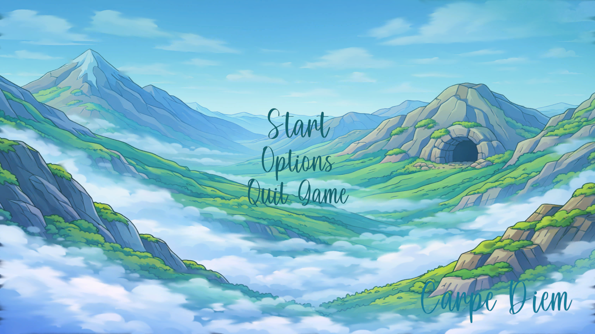
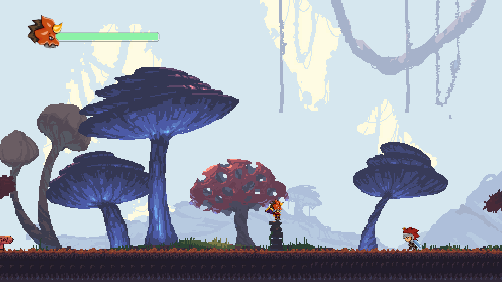
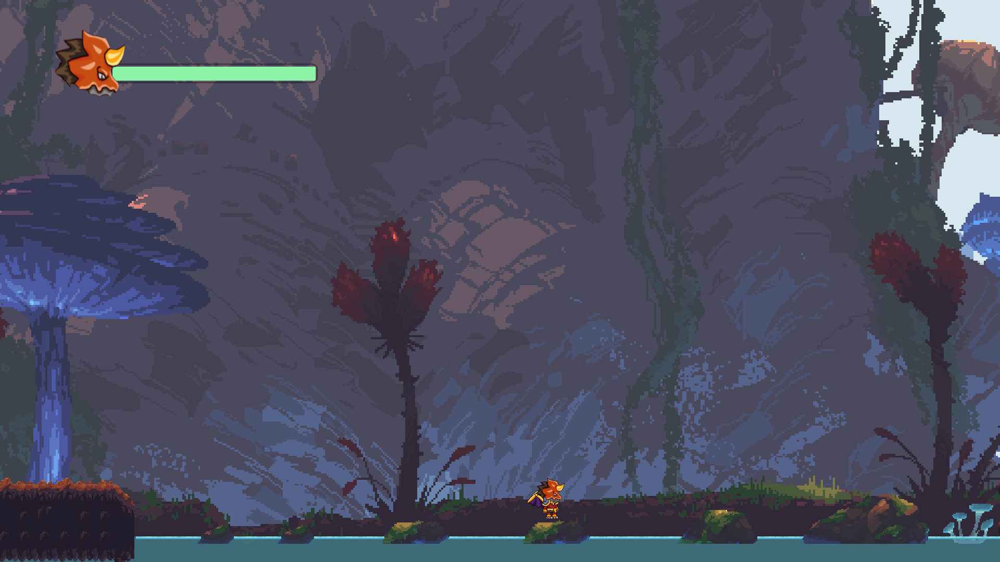
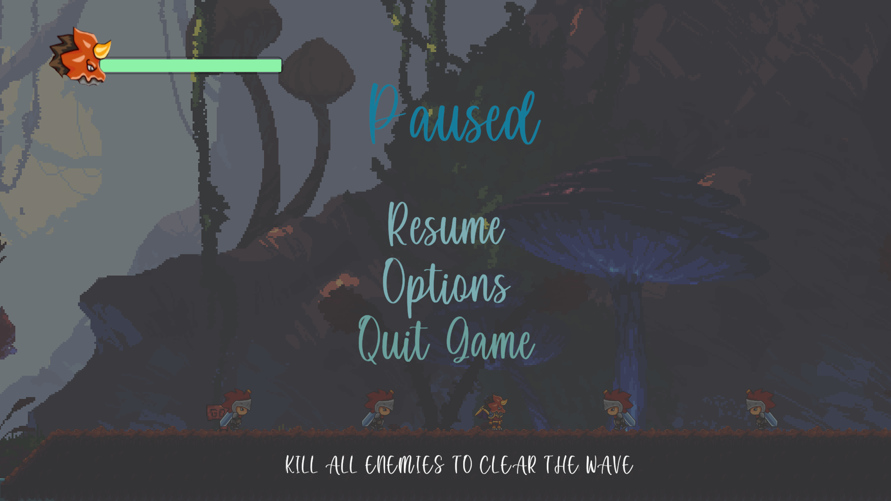
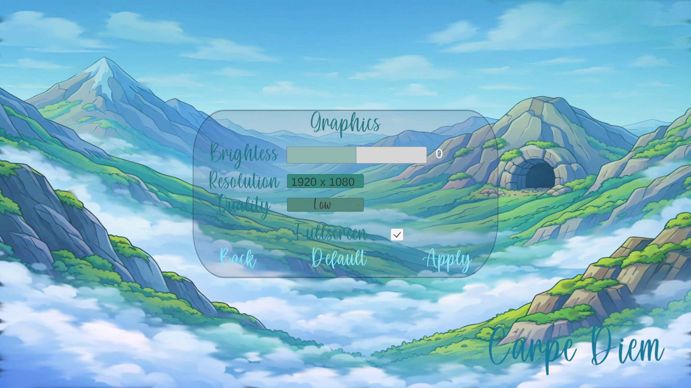

# Carpe Diem

A 2D platformer made in Unity. You play as a dragon fighting back against the knights who set out to hunt it. Clear out every knight, jump across the water, and reach the goal.

## Play it

Download **CarpeDiem-Windows.zip** from the [latest release](https://github.com/tea4ai/Carpe-Diem/releases/latest), unzip it and run `Carpe Diem.exe`.
Windows may show a SmartScreen warning because the game is unsigned. Click *More info → Run anyway*.

## Controls

| Key | Action |
|---|---|
| A / D | Move |
| W | Jump |
| Space | Shoot a fireball |
| Esc | Pause menu |

## How to win

The dragon can only attack with fireballs, while the knights fight with swords and chase you down. Defeat all the knights and get across the water to the goal sign to clear the level.

## Features

- Enemy AI that chases the player, with sword-fighting knights
- Parkour section with water jumps
- Parallax scrolling background and a camera that follows the player within level bounds (Cinemachine Confiner)
- Main menu, pause menu, loading screen and "You Died"/"You win" screen
- Graphics options (brightness, resolution, quality, fullscreen)

## Team

Made by [tea4ai](https://github.com/tea4ai) and [yavmomdev](https://github.com/yavmomdev).

**tea4ai:** game idea, all enemy work (knights, chasing system, animations), level design, main menu, "You Died" screen, camera confiner, parallax background.

**yavmomdev:** player character, QA testing, audio, loading screen and pause menu.

## Built with

Unity 6000.3.10f1 (Unity 6.3 LTS), Universal Render Pipeline (2D), C#.

## Running the project in Unity

The third-party art is not included in this repository. To open the project, install Unity `Unity 6000.3.10f1`, clone the repo, and import the assets below into the project:

- Dragon Warrior sprites: `https://assetstore.unity.com/packages/2d/characters/dragon-warrior-free-93896`
- Knight sprites: `https://assetstore.unity.com/search?q=knight+2d`

## Credits

- Music generated with ElevenLabs
- Background in the level and fonts: `https://www.1001fonts.com/pletty-book-font.html`
